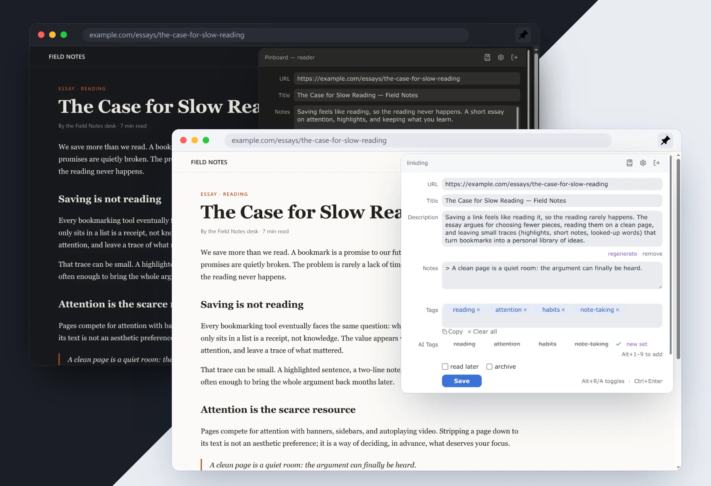
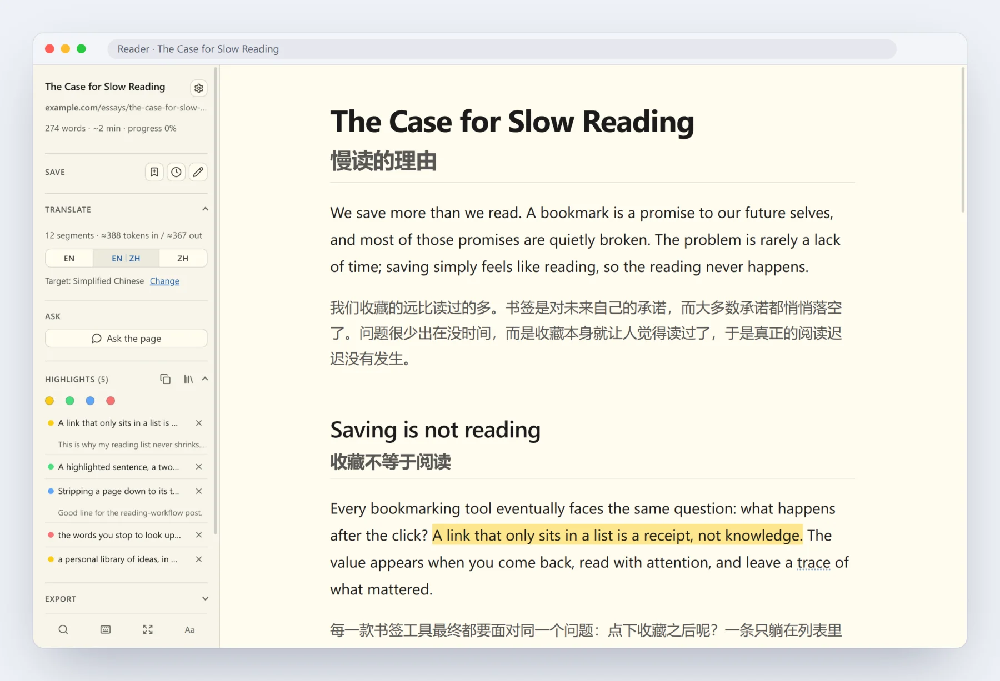
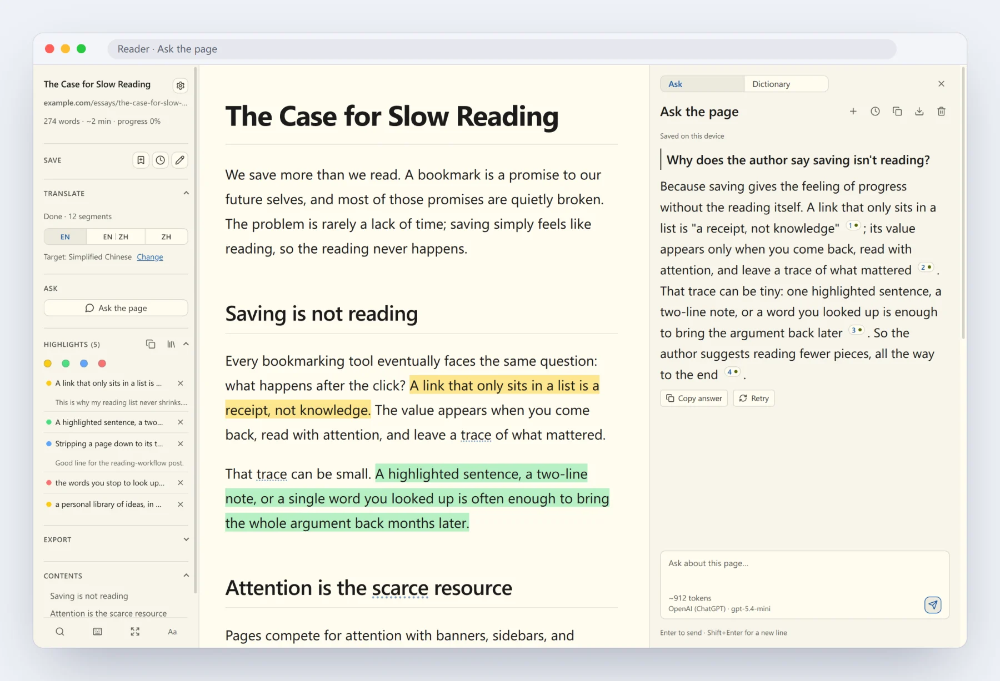
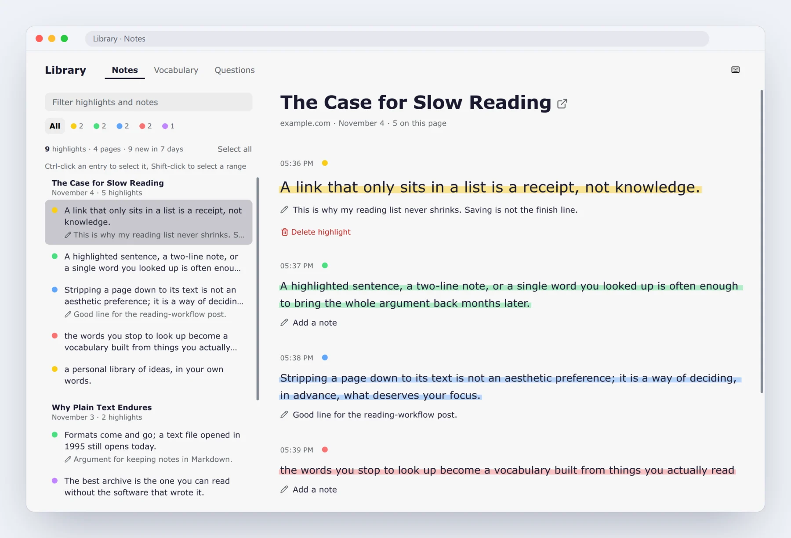
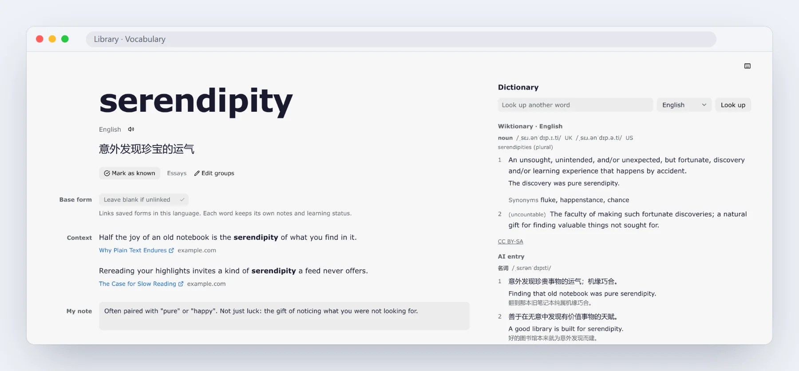
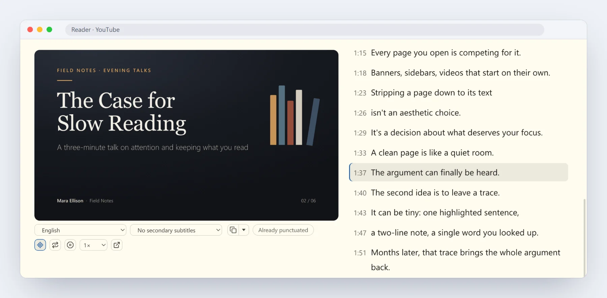
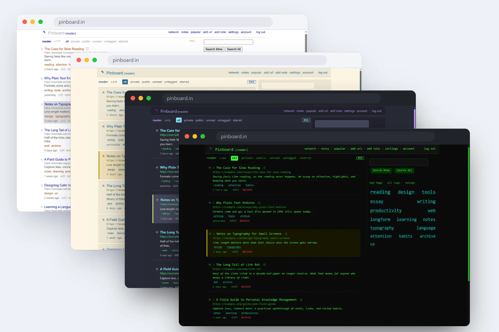

# 书签增强

[English](README.md) | **简体中文** | [繁體中文](README.zh-TW.md) | [繁體中文（香港）](README.zh-HK.md) | [Deutsch](README.de.md) | [Français](README.fr.md) | [日本語](README.ja.md) | [Polski](README.pl.md) | [Русский](README.ru.md)

支持 [Pinboard](https://pinboard.in)、Karakeep 和 linkding 的 Chrome 扩展：AI 标签与摘要、带翻译和高亮的阅读器，以及 13 套 pinboard.in 站点主题。

> **说明：** 在设置中选择一种书签服务。使用 Karakeep 或 linkding 无需 Pinboard 账号。Pinboard 是独立的**付费**服务，使用时需自备账号和 API Token。本扩展是第三方客户端，与 Pinboard 官方无关，未获其赞助或认可。

---

## 功能特性

### 保存
- **一键保存，信息自动填好**：标题、描述和选中文本一并填入，并去掉 URL 里的追踪参数
- **快捷键与批量保存**：不开弹窗直接保存，或一次收藏当前窗口的所有标签页
- **断网也能保存**：先进本地队列，恢复联网后自动重试
- **草稿不丢**：关掉弹窗再打开，接着写

### 标签
- **AI 生成标签和摘要**：只读文章正文，不掺广告、菜单和侧边栏；自备 API Key，17 家服务商或任意 OpenAI / Anthropic 兼容接口
- **标签自动补全**：历史标签、Pinboard 建议、一键预设
- **标签治理**：合并近似标签，清理低频标签

### 阅读
- **网页变成清爽的阅读器**：Markdown 视图，带目录、搜索和脚注速览；公式、图表、表格都正常显示
- **GitHub Discussions（试点）**：保留已加载的主帖、评论、回复关系和采纳标记，并说明提取范围
- **阅读时管理书签**：在阅读器里保存、编辑或删除书签，不用切回弹窗
- **五色高亮与笔记**：切换翻译、原文改动后仍留在原处
- **整页翻译，或向文章提问**：双语对照；回答附引用，点击直达原文出处
- **问答连同引用一起留存**：完成后自动保存，连接 Google Drive 后同步；可在问答页查看历史、回阅读器继续提问，或单独导出、附在正文后。临时对话不保存。
- **边读边查词**：查看词典释义和发音；生词一键发到 Anki 和欧路词典，还可以选择离线汉英、英汉词典包。AI 词条释义可单独选择语言，生词本支持按语言筛选。 查词气泡可拖动边缘调整大小，也可移入右侧面板；切换位置时保留当前结果、选定释义和生成进度。从 Wikisource 的作品里读到这个词的真实原句，附作者与出处，不用 AI。
- **多语言离线词典**：导入 Yomitan v3 ZIP 文件，即可在本机查阅释义和读音；词典包不参与 Drive 同步，也不包含在 JSON 备份中。 所有离线词典（包括汉英和英汉词典）均可停用，数据继续保留在本机。 可识别的释义会与例句、词源分开呈现，其他内容保留为完整词条供阅读。旧词包需重新导入以重新识别结构，已有生词和词包启用状态保持不变。
- **AI 词条**：先用母语或指定语言生成词义、发音和例句，需要时再补充用法要点和词源。补充内容部分有效时会保留有效部分并注明。完整结果随已连接的 Google Drive 同步，更新保留旧版。词典结果与 AI 内容在同一栏依次排开，生成时实时显示进度，要保存的释义始终留在底部。基础词条的自动生成需另行开启。
- **结合文章理解选中文本**：使用“解释”了解词语或段落在当前文章中的含义；查词提供词语的常见含义和用法。
- **资料库**：集中查看高亮、笔记、生词和已保存的问答，随手查词、批量管理生词。可直接保存查词结果并选择释义，通过可编辑的原形关联词形；各词保留独立笔记和学习状态。
- **生词完整导出**：可选择独立的多语言 Anki 笔记类型，区分不同语言的同形词；完整 TSV 保留笔记、原形及每段语境的来源，原有六字段格式仍可使用
- **发送或下载**：[Obsidian](https://obsidian.md)、Notion、NotebookLM、GitHub Gist 或任意 webhook；`.md`、`.html`、`.epub` 供电子书阅读器
- **边读边看**：YouTube 和 B 站视频旁边配上随播放滚动的字幕，AI 标签和摘要可以直接读字幕

### 个性化
- **13 套 pinboard.in 主题**（Dracula、Nord、Catppuccin、Solarized 等），还能叠加自定义 CSS
- **自动存档到 [Wayback Machine](https://web.archive.org)**：每次保存都留一份快照，原链接失效也能找回
- **备份与同步**：设置走 Chrome Sync，生词、高亮、笔记、AI 词条和问答记录走自己的 Google Drive；JSON 备份包含设置、生词、高亮与笔记
- **9 种语言**、可自定义快捷键、本地优先存储、零追踪

## 安装

**[→ 从 Chrome 网上应用店安装](https://chromewebstore.google.com/detail/pinboard-bookmark-enhance/pnjndmjhljjbdlbejeenkepdalokfooh)**（推荐）

或从 release ZIP 手动加载：
1. 下载最新的 [release ZIP](https://github.com/pine2D/Pinboard-Bookmark-Enhanced/releases/latest)
2. 解压
3. `chrome://extensions/` → 开启**开发者模式** → **加载已解压的扩展程序** → 选择解压后的目录

源码目录使用独立且固定的开发版 ID，可与 Chrome 网上应用店版本共存，方便测试。release ZIP 使用 Chrome 网上应用店 ID，不能与商店版同时安装在同一 Chrome 个人资料中。在每台设备上开启设置同步后，Chrome Sync 即可共享设置。如果要替换较早的解压安装版，先在旧版设置页点「导出备份」，加载新版后再点「导入备份」。

安装后打开**设置 → 账号**，选择书签服务。使用 Karakeep 或 linkding 时，填写站点地址和 API Token，点击**连接**并允许访问该服务器。地址需包含部署子路径；除本机 localhost 外，必须使用 HTTPS。Karakeep 需要 0.31 或更高版本（已在 0.34.1 上测试）。使用 Pinboard 时，在弹窗粘贴 [API Token](https://pinboard.in/settings/password) 后登录。

弹窗、阅读器、快捷键和批量保存均使用所选服务。Karakeep 的「稍后阅读」使用专用私有列表，标为已读会从列表移除，不改变服务内的归档状态。linkding 使用未读标记。Pinboard 建议、标签治理、未读数量、站点搜索和标签页集仅供 Pinboard 使用。

三种服务共用一个个人资料库，包含生词、高亮、笔记、AI 词条归档和 Ask 历史。切换服务或退出书签账号不会切换资料库。升级时保留当前 Pinboard 资料库，不自动合并其他历史账号。书签缓存、草稿和离线队列仍绑定原连接；退出 linkding 后再连接算新连接，原连接下排队的待保存项不会自动重试。

## 隐私

零追踪、零分析、零遥测。新用户的设置和凭据默认保存在本机。普通设置同步需在每台设备上分别开启。凭据同步是 Chrome 账号级选项，但只有开启普通设置同步的设备才会参与；关闭普通设置同步的设备继续使用本地凭据。新用户的凭据同步默认关闭；若升级时 Chrome Sync 已有非空凭据，则为避免数据丢失会保持开启。开启后，API Key、Token、密码和导出凭据会通过 Chrome Sync 共享，只做混淆，没有加密。书签内容、页面内容和离线队列不会通过 Chrome Sync 同步。AI 请求**只**来自你开启或使用的 AI 功能，并直接发往你配置的服务商。安装时只授予 Pinboard 访问权限。其他站点（AI 服务商、导出或存档目标、词典、Google Drive、视频字幕，以及批量保存涉及的站点）都在你首次使用相应功能时逐个申请，且只申请精确站点。自定义网络端点必须使用 HTTPS；HTTP 仅允许用于 `localhost`、`127.0.0.1` 和 `[::1]`。扩展页面强制执行严格的内容安全策略（Content-Security-Policy，禁止远程代码）。完整政策：<https://pine2d.github.io/Pinboard-Bookmark-Enhanced/privacy.html>

Google Drive 需在每台设备上分别连接，连接后同步个人资料库的生词、高亮、笔记、完整 AI 词条和补充用法，以及保存的问答与原文证据。Drive 私有 appDataFolder 中的副本是明文，未经端到端加密。可选词源资料来自维基词典。扩展会核对原文，将短摘录及相关来源信息发送给所选 AI 服务商；用法要点里的例句由 AI 编写。原文用例从 Wikisource 检索，原样显示、不翻译，也不发送给 AI。已有付费结果继续保留，只有主动更新才生成新版。

使用生词同步的设备都需要更新扩展。新版可以读取已有生词数据，但旧版无法接收新版写入的生词更改。

## 许可证

MIT，见 [LICENSE](LICENSE)。
